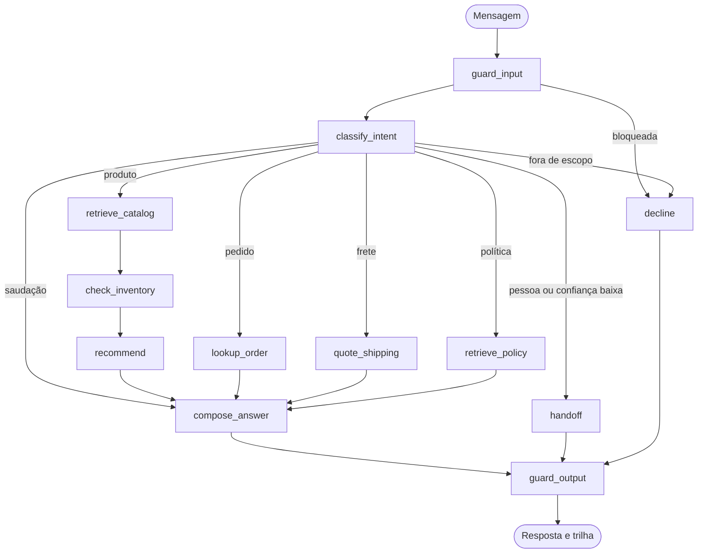

# ShopMind

[](https://github.com/helisondias07/shopmind-agent/actions/workflows/ci.yml)
[](https://www.python.org/)
[](LICENSE)

Agente de atendimento da loja fictícia **Lume & Co.** Um grafo LangGraph consulta o catálogo, o estoque e as políticas antes de responder, cita a fonte e passa a conversa para uma pessoa quando a confiança é baixa.

Support agent for the fictional shop **Lume & Co.** A LangGraph workflow reads the catalog, stock, and policies before it answers, cites the source, and hands the conversation to a person when confidence is low.

**Demo:** `https://<seu-projeto>.vercel.app` — substitua pelo endereço do `vercel deploy`.

**Author:** Helison Dias · **License:** MIT

---

## Português

### O que é

O ShopMind atende no balcão da Lume & Co., uma loja de mesa e casa que só existe neste repositório. Ele não inventa preço nem estoque. Cada número da resposta precisa estar no SQLite ou na política citada. Se o cliente pede uma pessoa, ou se a mensagem não dá para classificar, o grafo encerra com um protocolo de handoff.

A demo em `web/` é uma vitrine com o chat ao lado e um painel que mostra, em tempo real, os nós visitados, as tools chamadas, a intenção e a latência.

Sem `OPENAI_API_KEY` e sem `ANTHROPIC_API_KEY`, tudo roda em modo determinístico. Com uma das chaves, os nós de classificação e de redação passam a usar o modelo, e o guard de saída continua no comando: rascunho com preço fora da base é trocado pelo texto montado a partir dos dados.

### Grafo



O estado é um `TypedDict`. A lista de mensagens usa o redutor `add_messages`, e o grafo compilado recebe um checkpointer (`SqliteSaver` no processo local, `MemorySaver` nos testes). O `thread_id` é o `session_id`, então um segundo turno lembra o pedido ou o produto anterior. O widget também reenvia o histórico recente: se a instância serverless esfriar, a conversa continua.

### Exemplo gerado

Saída real de `python -m shopmind demo --markdown` com `LLM_PROVIDER=fake`. O arquivo completo está em [`examples/transcripts.md`](examples/transcripts.md).

```text
Shopper: Quanto custa a luminária Lume?

Luminária Lume (LUME-LAMP) custa R$ 289,00. Há 14 unidades em estoque. Abajur de mesa com braço articulado, luz quente regulável e base de cerâmica fosca. Pensada para leitura e para o trabalho noturno. Na mesma categoria: Carregador Sol, Suporte Atlas.
Fonte: catálogo LUME-LAMP.

intent product
nodes guard_input → classify_intent → retrieve_catalog → check_inventory → recommend → compose_answer → guard_output
tools search_knowledge, check_inventory, recommend_products
```

```text
Shopper: Cadê o pedido LM-1042?

Pedido LM-1042 de Ana: enviado. Transportadora Lume Express, rastreio LMX-1042-BR. Saiu do centro de distribuição em São Paulo. Itens: Fone Nimbus (1 × R$ 649,00).
Fonte: pedido LM-1042.

Shopper: Pode repetir o rastreio?

Pedido LM-1042 de Ana: enviado. Transportadora Lume Express, rastreio LMX-1042-BR.
```

```text
Shopper: Quanto fica o frete do fone Nimbus para 01001-000?

Frete para 01001-000 (São Paulo): grátis, porque o pedido chega a R$ 299,00 ou mais. Prazo de até 2 dias úteis.
Fonte: política de frete.
```

```text
Shopper: Quero falar com uma pessoa

Vou passar você para um atendente humano. Protocolo LM-H-59F3D8. Você pediu para falar com uma pessoa.
```

### Arquitetura

```mermaid
flowchart LR
  browser[Next.js em web/]
  api[FastAPI em api/]
  graph[LangGraph]
  tools[Tools LangChain]
  db[(SQLite / SQLAlchemy)]
  index[Vector store local]
  browser -->|/api/chat e /api/products| api --> graph --> tools
  tools --> db
  tools --> index
```

| Peça | Onde | Papel |
| --- | --- | --- |
| Grafo | `api/shopmind/agent/workflow.py` | Estado, roteamento condicional, checkpointer |
| Classificação e resposta | `agent/classifier.py`, `agent/composer.py` | Saída estruturada com Pydantic. O modo fake devolve o mesmo contrato |
| Tools | `tools/registry.py` | Busca, estoque, recomendação, pedido, frete |
| Banco | `db/models.py`, `services/` | Catálogo, políticas e pedidos |
| RAG | `rag/` | Embeddings e índice em memória, com opção FAISS |
| HTTP | `api/app.py` | `/api/chat`, streaming SSE, produtos, evals |
| Demo | `web/` | Vitrine, chat, trilha do grafo, página de evals |

### Decisões

- O grafo é um workflow com nós explícitos, não um loop livre de tool calling. O caminho fica testável e o painel consegue desenhar cada passo.
- O índice guarda texto e identificadores. Preço e estoque são lidos de novo no SQLite na hora da resposta, pela tool `check_inventory`.
- O vector store padrão é o `InMemoryVectorStore` do LangChain, com similaridade de cosseno. Ele sobe na Vercel e no CI sem biblioteca nativa. `VECTOR_STORE=faiss` usa FAISS quando `faiss-cpu` e `langchain-community` estão instalados.
- Embeddings padrão são um hash determinístico das palavras. Com `EMBEDDINGS=openai` e uma chave, o índice passa a usar `text-embedding-3-small`.
- O provedor do chat é `LLM_PROVIDER=auto|fake|openai|anthropic`. `auto` escolhe OpenAI, depois Anthropic, e cai no modo fake se não houver chave. Uma falha do modelo também cai no renderizador determinístico, para a demo não quebrar.
- Pedidos e políticas vivem em JSON versionado e são carregados no SQLite na subida. O JSON é a fonte que se lê no pull request; o banco é o que as tools consultam.

### Como rodar

```bash
python3 -m venv .venv
source .venv/bin/activate
pip install -r requirements-dev.txt
cp .env.example .env

make api
# outro terminal
cd web && npm install && npm run dev
```

Abra `http://127.0.0.1:3000`. A API fica em `http://127.0.0.1:8000`.

```bash
make test
make lint
PYTHONPATH=api python -m shopmind chat "Quanto custa a luminária Lume?"
PYTHONPATH=api python -m shopmind eval
docker build -t shopmind .
docker run --rm -p 8000:8000 -e LLM_PROVIDER=fake shopmind
```

Para um modelo de verdade, exporte `OPENAI_API_KEY` ou `ANTHROPIC_API_KEY` e deixe `LLM_PROVIDER=auto`.

### API

| Método | Caminho | Função |
| --- | --- | --- |
| `GET` | `/api/health` | Provedor, modelo, embeddings |
| `GET` | `/api/products?locale=pt` | Vitrine |
| `POST` | `/api/chat` | Uma resposta JSON |
| `POST` | `/api/chat/stream` | SSE: `node`, `token`, `done` |
| `GET` | `/api/evals` | Suite determinística, sem gastar token |
| `GET` | `/api/docs` | OpenAPI |

A mensagem aceita no máximo 2000 caracteres, o histórico no máximo 12 turnos, e o corpo no máximo 64 KB. Acima do limite por minuto a rota de chat responde `429`.

### Evals

Dezessete casos em `api/shopmind/evals/cases.json`: preço, estoque esgotado, pedido, memória de sessão, frete grátis, política de 30 dias, handoff, fora de escopo, injeção de prompt, cartão mascarado e preço inventado. O `pytest` executa a suite. A página `/evals` mostra o mesmo relatório.

### Segurança

- Chaves só por ambiente. `.env.example` não tem segredo.
- O nó `guard_input` recusa pedidos para ignorar instruções ou revelar o prompt, em português e em inglês.
- Sequências com cara de cartão são substituídas por `[redacted-card]` antes do classificador.
- O nó `guard_output` confere cada valor em `R$` e cada contagem de estoque contra o payload das tools. Se o rascunho inventa um número, ele é descartado e a resposta sai do template.
- Cabeçalhos `X-Content-Type-Options`, `Referrer-Policy` e `X-Frame-Options`.
- O limite de taxa é por processo. Numa frota, o lugar dele é um contador compartilhado.

### Deploy

**Vercel (demo completa).** O `vercel.json` usa [Vercel Services](https://vercel.com/docs/services) (beta): o serviço `web` é o Next.js e o serviço `api` é o FastAPI (`api/index.py`, entrypoint `index:app`). Um `vercel deploy` na raiz publica os dois. O rewrite manda `/api/*` para o Python e o resto para o frontend.

```bash
npm i -g vercel
vercel deploy
```

No painel, deixe `LLM_PROVIDER=fake` para a demo sem chave, ou defina `OPENAI_API_KEY` / `ANTHROPIC_API_KEY`. Na Vercel o SQLite e o checkpointer usam `/tmp`, então a memória de sessão dura enquanto a instância estiver quente. O widget reenvia o histórico por isso.

**Render.** Web Service a partir do `Dockerfile`, porta `8000`, health check `/api/health`, `LLM_PROVIDER=fake` ou a chave do modelo. Isso publica a API. O frontend pode continuar na Vercel com `SHOPMIND_API_ORIGIN` apontando para o host do Render.

**Fly.io.** `fly launch` com o Dockerfile, porta interna `8000`, e os mesmos segredos via `fly secrets set`. Não coloque a chave na imagem.

**AWS.** App Runner ou ECS/Fargate a partir da imagem. Porta `8000`, health check `GET /api/health`, variáveis no serviço (Secrets Manager ou a definição da task), não no repositório. O SQLite serve para uma instância só; um Postgres entra trocando `DATABASE_URL` e instalando o driver.

### Observabilidade

Cada turno escreve uma linha JSON em stdout (`event`, `intent`, `nodes`, `tools`, `latency_ms`), sem a mensagem completa. A resposta da API traz a mesma trilha para o painel. Com `LANGSMITH_TRACING=true` e `LANGSMITH_API_KEY`, o processo exporta os traces do LangChain para o projeto `LANGSMITH_PROJECT`.

### Desenvolvimento

O projeto foi escrito com apoio de agentes de código (Cursor e Claude Code). [AGENTS.md](AGENTS.md) e [CLAUDE.md](CLAUDE.md) dizem o que esses agentes devem preservar: modo fake nos testes, nada de segredo no git, e o grafo alinhado com o diagrama e com as evals.

---

## English

### What it is

ShopMind is the counter for Lume & Co., a home-and-desk shop that exists only in this repository. It does not invent a price or a stock count. Every figure in a reply has to be in SQLite or in the policy it cites. If the shopper asks for a person, or the message cannot be classified, the graph stops with a handoff protocol.

The page in `web/` is the shop floor, the chat, and a live trace of the nodes, tools, intent, and latency.

With no API key the agent is deterministic. With `OPENAI_API_KEY` or `ANTHROPIC_API_KEY`, classification and wording use that model, and the output guard still replaces any draft that cites a price missing from the tool payload.

### Graph

The diagram in the Portuguese section is the graph. State is a `TypedDict`. Messages use the `add_messages` reducer, and the compiled graph takes a checkpointer: `SqliteSaver` locally, `MemorySaver` in tests. `thread_id` is the `session_id`. The widget also sends recent history so a cold serverless instance can continue the conversation.

### Generated example

The blocks above are the real output of `python -m shopmind demo --markdown` under `LLM_PROVIDER=fake`. The full transcript is [`examples/transcripts.md`](examples/transcripts.md). A second turn in the same session repeats the tracking code `LMX-1042-BR` without the shopper sending the order id again.

### Architecture

Browser to FastAPI to LangGraph to LangChain tools. Tools read SQLite through SQLAlchemy and a local vector store. See the table above for the modules.

### Decisions

- Explicit nodes instead of an open tool-calling loop, so the path is testable and the trace panel can draw it.
- The index stores passages and ids. `check_inventory` reloads price and stock from SQLite at answer time.
- Default vector store is LangChain's `InMemoryVectorStore`. `VECTOR_STORE=faiss` is supported when `faiss-cpu` and `langchain-community` are installed.
- Default embeddings are a deterministic word hash. `EMBEDDINGS=openai` uses `text-embedding-3-small`.
- `LLM_PROVIDER=auto` picks OpenAI, then Anthropic, then the fake renderer. A provider error falls back to the same renderer so the demo still answers.
- Catalog, policies, and orders are JSON loaded into SQLite on startup.

### Run

```bash
python3 -m venv .venv && source .venv/bin/activate
pip install -r requirements-dev.txt
cp .env.example .env
make api
# second terminal
cd web && npm install && npm run dev
```

Open `http://127.0.0.1:3000`. Tests: `make test` and `make lint`. One turn: `PYTHONPATH=api python -m shopmind chat "How much is the Nimbus headphone?"`.

### API, evals, security

`POST /api/chat` and `POST /api/chat/stream` (SSE events `node`, `token`, `done`). `GET /api/evals` runs the 17 deterministic cases. Messages are capped at 2000 characters, history at 12 turns, bodies at 64 KB, and chat is rate-limited per process (`429`).

The input node blocks prompt-injection phrasing and redacts card-like numbers. The output node checks every `R$` amount and every stock count against the tool payload. Secrets stay in the environment. See `.env.example`.

### Deploy

**Vercel.** `vercel.json` uses Vercel Services (beta): Next.js in `web/`, FastAPI at `api/index.py` (`index:app`). `vercel deploy` from the repository root ships both. `/api/*` goes to Python. Set `LLM_PROVIDER=fake` for the keyless demo, or set a provider key. SQLite and the checkpointer use `/tmp` on Vercel.

**Render.** Docker web service, port `8000`, health check `/api/health`.

**Fly.io.** `fly launch` from the Dockerfile, internal port `8000`, secrets via `fly secrets set`.

**AWS.** App Runner or ECS/Fargate from the image. Port `8000`, health check `/api/health`, secrets on the service rather than in the image. SQLite is single-instance; a server database is a `DATABASE_URL` change plus a driver.

### Observability and development

Each turn logs one JSON line: intent, nodes, tools, latency. The API returns the same trace to the panel. Set `LANGSMITH_TRACING=true` and `LANGSMITH_API_KEY` to export LangChain traces.

The project was built with help from coding agents (Cursor and Claude Code). [AGENTS.md](AGENTS.md) is the working agreement for those agents.
